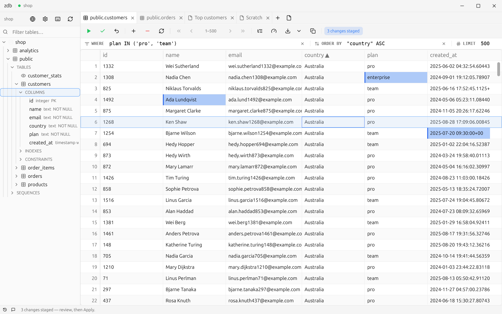
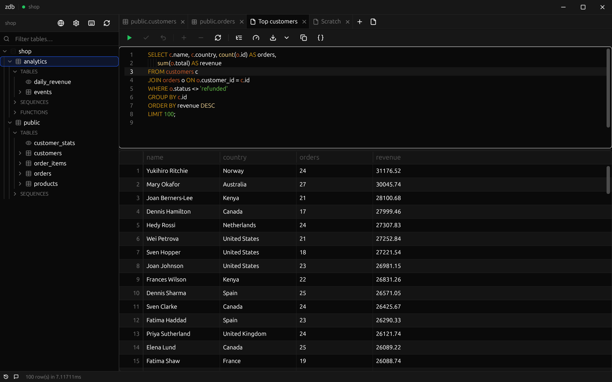
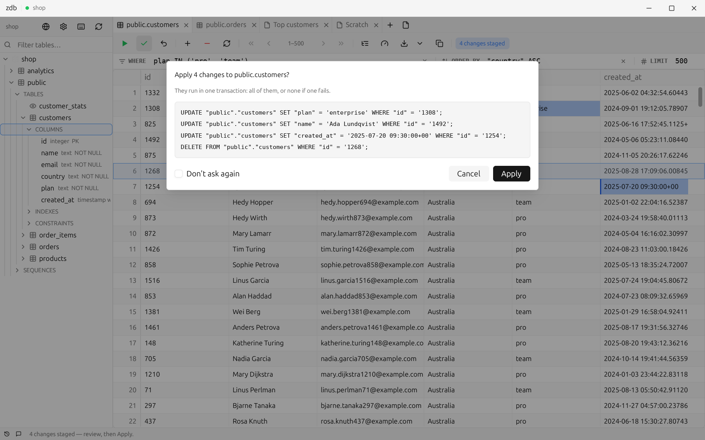
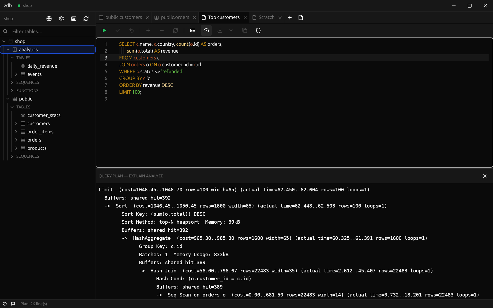

# zdb

A fast, minimal PostgreSQL desktop client in Rust, built on
[GPUI](https://www.gpui.rs/) (Zed's UI framework). Linux, Windows and macOS.



<table>
  <tr>
    <td width="33%"></td>
    <td width="33%"></td>
    <td width="33%"></td>
  </tr>
</table>

## Features

- Schema tree, tabs saved per connection, passwords in the OS keychain
- SQL editor with highlighting and schema-aware completion
- Tables with WHERE / ORDER BY / LIMIT boxes and a pager
- Inline editing: changes are staged, reviewed and applied in one transaction
- EXPLAIN, export to CSV / JSON / `INSERT`s
- Queries run side by side across tabs, each with its own Stop
- Embedded terminal, keyboard-driven everything (`F1` lists the shortcuts), light and dark themes

## Install

Download the zip for your system from the
[latest release](https://github.com/tochk/zdb/releases/latest). Keep `sqls` next to the app:
completion needs it.

## Build

```bash
cargo run -p zdb-app
```

Linux needs `pkg-config libx11-dev libxcb1-dev libxkbcommon-dev libxkbcommon-x11-dev
libwayland-dev libfontconfig1-dev libvulkan-dev libgl1-mesa-dev libdbus-1-dev`. Build Windows
binaries on Windows (MSVC + the Windows SDK). `make sqls` builds the completion server (needs Go).

## Develop

```bash
cargo test
ZDB_TEST_HOST=127.0.0.1 ZDB_TEST_USER=zdb ZDB_TEST_DB=zdb ZDB_TEST_PASSWORD=zdb cargo test  # with Postgres
make fmt
make clippy
```
